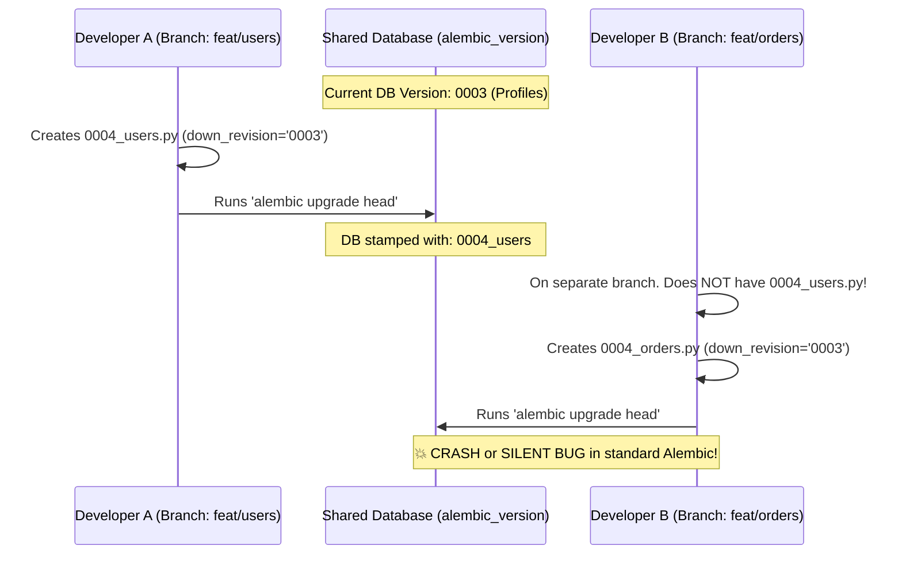

# 🔍 Under the Hood: How `alembic-autoseq` Manages Conflicts

This document explains the internal mechanics of `alembic-autoseq` when handling parallel migrations, duplicate sequence numbers, and shared database desynchronization.

---

## 🎯 Scenario: The "Another Developer Already Migrated" Problem

Consider a typical team setup:
* Multiple developers are working on separate Git branches.
* Developers share a common dev/staging database (or switch between Git branches locally).

### 1. The Timeline of the Conflict



---

## ❌ Why Standard Alembic Fails Underneath

When Developer B runs `alembic upgrade head`:

1. **Failure Mode A: The "Missing Revision" Crash**
   - Alembic inspects `alembic_version` in the database and reads `'0004_users'`.
   - Alembic searches Developer B's local `versions/` directory for `'0004_users'`.
   - It cannot find it (because Dev A's code hasn't been merged or pulled to Dev B's branch).
   - **Crash:** 
     ```text
     alembic.util.exc.CommandError: Can't locate revision identified by '0004_users'
     ```

2. **Failure Mode B: The "Silent Skipped Migration" Bug (Duplicate Revision ID)**
   - If both developers used the exact same revision string `'0004'`:
   - Alembic reads `'0004'` from the database.
   - Alembic checks Dev B's local files, sees Dev B has revision `'0004'` (`0004_orders.py`).
   - Alembic thinks: *"Oh, revision 0004 is already applied to this database!"*
   - **Result:** Alembic skips running Dev B's migration entirely. Dev B's `orders` table is never created, causing runtime SQL errors (`Table 'orders' doesn't exist`).

---

## 🛡️ How `alembic-autoseq` Manages It Underneath

When `alembic_autoseq.guard()` runs (either in `env.py` or CLI), it executes a **3-stage reconciliation pipeline**:

```
                       alembic_autoseq.guard()
                                  │
         ┌────────────────────────┴────────────────────────┐
         ▼                                                 ▼
[Stage 1: AST Codebase Scan]                     [Stage 2: Database Sync Inspection]
• Reads all files in versions/                   • Queries 'alembic_version' table
• Parses revision & down_revision                • Reads active DB stamp: ['0004_users']
• Extracts sequence numbers (0001..0004)         • Compares DB stamps against local DAG
         │                                                 │
         └────────────────────────┬────────────────────────┘
                                  ▼
                   [Stage 3: Multi-Layer Conflict Resolver]
                                  │
         ┌────────────────────────┴────────────────────────┐
         ▼                                                 ▼
   Code Conflict?                                    Database Conflict?
(Multiple Heads or Duplicate IDs)                (Orphan Stamp from Peer Dev)
         │                                                 │
         ▼                                                 ▼
• Re-sequences branch migration                  • Identifies lowest common ancestor
  (0004_orders.py -> 0005_orders.py)               (Revision '0003')
• Sets down_revision = '0004_users'              • Atomically re-stamps DB to '0003'
• Atomically renames file on disk                          │
         │                                                 │
         └────────────────────────┬────────────────────────┘
                                  ▼
                 [Stage 4: In-Memory Alembic Sync]
                 • Reloads context.script.revision_map
                 • Hands clean linear DAG to Alembic
                 • 'alembic upgrade head' succeeds!
```

---

### Step-by-Step Breakdown

#### 1. Code-Level Reconciliation: AST Rewriting
* `alembic-autoseq` parses migration files using Python's native `ast` module.
* It does **not** import or execute the migration code (preventing unsafe side effects).
* When two files have the same sequence prefix or branch from the same parent:
  1. It uses Git status (or file modification times) to identify which migration is the active branch work.
  2. It calculates the next safe sequence number:
     $$\text{new\_seq} = \max(\text{existing\_seq}) + 1$$
  3. It updates `revision = '0005'` and `down_revision = '0004_users'` directly in the script using regex substitution that preserves comments, docstrings, and indentation.
  4. It renames the file on disk: `0004_orders.py` $\rightarrow$ `0005_orders.py`.

#### 2. Database-Level Reconciliation: Orphan Stamp Healing
* When the database contains a revision that does **not exist** in Developer B's working copy:
  1. It flags `ConflictType.ORPHAN_DATABASE_REVISION`.
  2. It traverses the local DAG to find the **highest known ancestor** (in this case, `'0003'`).
  3. It resets the database `alembic_version` stamp to `'0003'`.
  4. Now the database and Developer B's codebase are back in sync. Developer B's new migration can execute cleanly without crashing.

#### 3. In-Memory RevisionMap Synchronization
* Alembic normally caches its revision tree once on startup.
* If a tool renames files on disk during execution, standard Alembic would still hold stale file references in memory.
* `alembic-autoseq` hooks directly into `context.script.revision_map`, refreshing the internal DAG cache in memory before `context.run_migrations()` is called.

---

## 🔒 Production Safety Guarantee

* **Past Migrations Are Immutable:** `alembic-autoseq` never touches historical migrations that have already been applied to production.
* **Non-Destructive DDL:** It only re-links down_revision pointers and sequence prefixes of active, unmerged branch migrations.
* **Deterministic:** Rebase decisions prioritize Git modified/untracked files first, ensuring local work always rebases onto upstream main cleanly.

